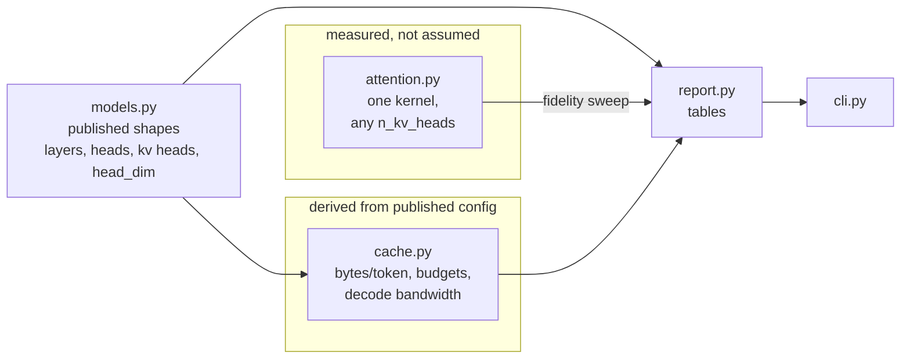

# grouped-query-attention-lab

Multi-head, grouped-query and multi-query attention are **one algorithm with one knob**.
This repository implements that algorithm once, prices the KV cache each setting produces,
and measures what merging key/value heads does to the attention output.

```bash
pip install -r requirements.txt
python cli.py                                  # Llama 3 70B, 8k context
python cli.py --model llama-3-8b --context 131072
python cli.py --catalogue
python cli.py --fidelity
pytest -q
```

## The knob

During decoding, a transformer keeps one key vector and one value vector per **key/value
head**, per layer, for every token it has seen. The three names people use are three
positions on the number of KV heads:

| `n_kv_heads` | name | what it means |
|---|---|---|
| `== n_heads` | MHA | every query head carries its own key and value head |
| `1 < n < n_heads` | GQA | query heads are divided into groups; each group shares one KV head |
| `== 1` | MQA | all query heads share a single KV head |

So there is no branch in `attention()` selecting a layout. There is a `group_size =
n_heads // n_kv_heads`, and each KV head is broadcast to the query heads in its group.

## Why anyone bothers

The cache formula is one line, and the interesting thing is what is missing from it:

```
bytes per token = 2 x n_layers x n_kv_heads x head_dim x bytes_per_element
                  ^                ^
                  K and V          the query-head count does NOT appear
```

Sharing key/value heads leaves the model's width, depth and query-head count untouched and
divides this number by the group size. For Llama 3 70B — 80 layers, 64 query heads, 8 KV
heads, head dimension 128, fp16:

| layout | kv heads | sharing | per token | cache at 8k | cache at 128k |
|---|---|---|---|---|---|
| MHA (hypothetical) | 64 | 1:1 | 2.50 MiB | 20.00 GiB | 320.00 GiB |
| **GQA (as released)** | **8** | **8:1** | **320 KiB** | **2.50 GiB** | **40.00 GiB** |
| MQA (hypothetical) | 1 | 64:1 | 40 KiB | 320.00 MiB | 5.00 GiB |

Eight query heads share one KV head, so this part of the cache is 8x smaller than the
equivalent multi-head layout would have been.

The capacity saving is the obvious half. The other half is **bandwidth**, and at long context
it is the half that decides throughput. Decoding one token means streaming every active
weight *and the entire cache so far* through the memory bus, so a cache 8x smaller is also 8x
fewer bytes read per step. At 8k context the 70B model's weights dominate and the layouts are
within ~15% of each other; at 128k the cache is larger than the weights and the multi-head
layout decodes several times slower. `python cli.py --context 131072` prints both.

## What it costs

Merging KV heads is not free, and `--fidelity` measures the cost directly. It takes a full
multi-head K and V, mean-pools them into progressively wider groups, and reports how far the
attention output moves from the multi-head result on identical inputs:

```
kv heads  layout  sharing  relative error
--------  ------  -------  --------------
1         MQA     8:1      (largest)
2         GQA     4:1
4         GQA     2:1
8         MHA     1:1      0.0000
```

Exactly zero at `n_kv_heads == n_heads` is the check that MHA really is this code path and not
a separate implementation. The error growing as the groups widen is why MQA, which is the
smallest cache of the three, is not simply the right answer: that much sharing costs quality.
GQA sits between them on purpose.

Pooling alone is the crude conversion. Published grouped checkpoints mean-pool the key and
value projections from a multi-head model and then continue pre-training briefly, which
recovers most of the gap — this repository does the pooling and skips the recovery, so the
numbers it prints are an upper bound on the damage.

## The thing people get wrong

**The layout is a property of the trained model, not a serving flag.** The KV-head count is
baked into the shape of the weight matrices. You cannot point a serving engine at a
multi-head checkpoint and ask for grouped-query attention; the MHA rows this tool prints are
what the architecture would have had to be. That distinction matters when you are deciding
which KV-cache technique to reach for: this one requires choosing a different model, while
paged caches, quantised caches and prefix reuse are all changes you can make to how an
existing model is served.

## Architecture



`attention.py` is the only module that computes anything numerical from data; `cache.py` is
closed-form arithmetic over the published shapes. They meet in `report.py`, which is
presentation only.

## Code map

| File | Responsibility |
|---|---|
| `gqa/attention.py` | The kernel. `attention()` handles any `n_kv_heads` that divides `n_heads`; `repeat_kv` broadcasts each KV head to its group; `causal_mask` handles the decode case where one query attends over a long cached prefix; `pool_kv` collapses KV heads by averaging groups; `fidelity_sweep` measures output drift against the full multi-head result. |
| `gqa/models.py` | `ModelShape` — the four numbers that determine the cache, plus validation that `n_heads` divides by `n_kv_heads`, `group_size`, and a `layout` label. `CATALOGUE` holds published shapes for GPT-2, Llama 2 7B/70B, Llama 3 8B/70B and Mistral 7B. |
| `gqa/cache.py` | The arithmetic: `kv_bytes_per_token`, `kv_bytes`, `max_context` (invert the formula against a memory budget), `decode_bytes_per_step` and `decode_tokens_per_second` (the bandwidth-bound throughput estimate), and `compare_layouts`, which prices MHA / as-released / MQA for the same model. |
| `gqa/report.py` | Table rendering: per-model layout comparison, whole-catalogue comparison, context-per-budget, decode bandwidth, and the fidelity sweep. No arithmetic of its own. |
| `cli.py` | Argument parsing and section ordering. |
| `tests/test_attention.py` | Checks the batched kernel against a naive per-head reference, that causal masking really zeroes the future, that MHA is the `n_kv_heads == n_heads` case, and that the fidelity sweep is exact at full width. |
| `tests/test_cache.py` | Pins the arithmetic to known values (Llama 3 70B at 320 KiB/token, 8x versus multi-head), checks that the query-head count never enters the formula, and validates every catalogue entry. |

## Caveats

- Throughput figures are a first-order, bandwidth-bound estimate: `bandwidth / bytes moved per
  step x efficiency`. They ignore kernel overhead, prefill, and any overlap. Use them to
  compare layouts against each other, not to predict a benchmark.
- The catalogue records total parameter counts to the nearest tenth of a billion, which is
  enough for the weight-bytes term and not enough for anything else.
- `pool_kv` is the naive conversion described above. It is a measurement tool here, not a
  recommended way to produce a grouped checkpoint.

## References

- [GQA: Training Generalized Multi-Query Transformer Models from Multi-Head Checkpoints](https://arxiv.org/abs/2305.13245)
- [Fast Transformer Decoding: One Write-Head is All You Need](https://arxiv.org/abs/1911.02150) — multi-query attention
- [The Llama 3 Herd of Models](https://arxiv.org/abs/2407.21783)
